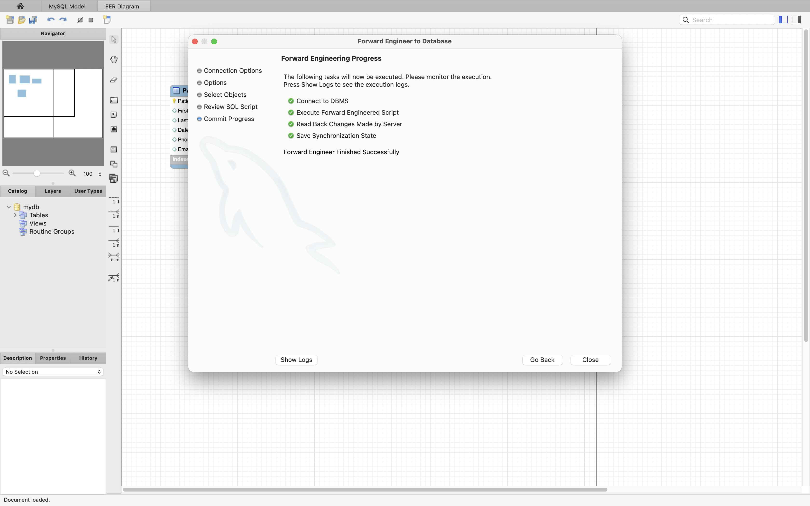

# Healthcare Patient Care Coordination System

**MySQL Workbench | SQL | Database Design**

## Project Overview

For my Introduction to Databases class at Georgia Gwinnett College, I created a healthcare database to organize information about patients, healthcare providers, departments, and appointments.

The goal was to learn how to design related tables, create a database from a model, add sample data, and use SQL to work with that data.

## How I Built It

### 1. Database Design

I started by creating an Enhanced Entity-Relationship (EER) diagram in MySQL Workbench. My design includes four tables: `PATIENT`, `HEALTHCARE_PROVIDER`, `DEPARTMENT`, and `APPOINTMENT`.

I used primary and foreign keys to connect the tables and show how the information relates.

### 2. Forward Engineering

Once my diagram was complete, I used the Forward Engineering feature in MySQL Workbench to generate the SQL needed to create the tables. This helped me see how the database design turns into actual tables in MySQL.

I also saved the generated SQL here: [healthcare_database_schema.sql](healthcare_database_schema.sql).

### 3. Adding Data

Next, I used `INSERT` statements to add fictional patient, provider, department, and appointment records. This gave me data to practice writing queries and checking whether the tables were connected correctly.

### 4. Writing SQL Queries

I practiced using `SELECT`, `JOIN`, and `WHERE` to retrieve information from multiple tables. For example, I wrote queries to find patients with scheduled appointments and see which providers they were assigned to.

I also worked with SQL concepts like `COUNT`, `GROUP BY`, and `ORDER BY` as part of learning how to summarize and sort data.

### 5. Testing the Database

I tested what happens when I try to add data that doesn't follow the database rules. For example, I tried adding an appointment with a patient ID that didn't exist.

I also added a `CHECK` constraint so appointment statuses would be limited to `Scheduled`, `Completed`, or `Cancelled`. Testing invalid entries helped me understand why constraints matter.

Some SQL statements from my classwork were written to produce errors on purpose, so they shouldn't all be run together as a setup script.

## Tools I Used

- **MySQL Workbench** — creating the EER diagram, forward engineering, and running SQL
- **MySQL** — storing the tables and sample data
- **SQL** — inserting records, writing queries, and testing constraints

## What I Learned

One of my biggest takeaways was seeing how everything connects. I started with a diagram, turned it into database tables, added records, and then used SQL to pull information from those tables.

I also learned that it's important to think about table relationships and data rules before adding information. When something didn't work, testing it helped me understand what the database was checking and why.

## What's Next

I want to keep building on this project by adding more tables and relationships as I learn more about database design. I'd also like to explore using Python or R to analyze appointment data and create visualizations.

---

*This is a class project. All patient and provider information is fictional.*
