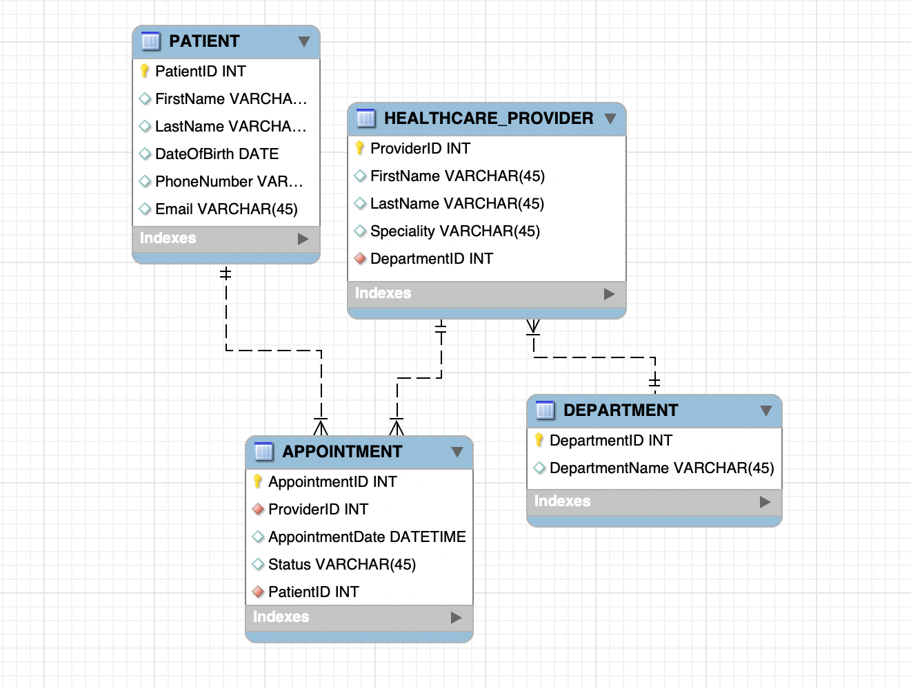
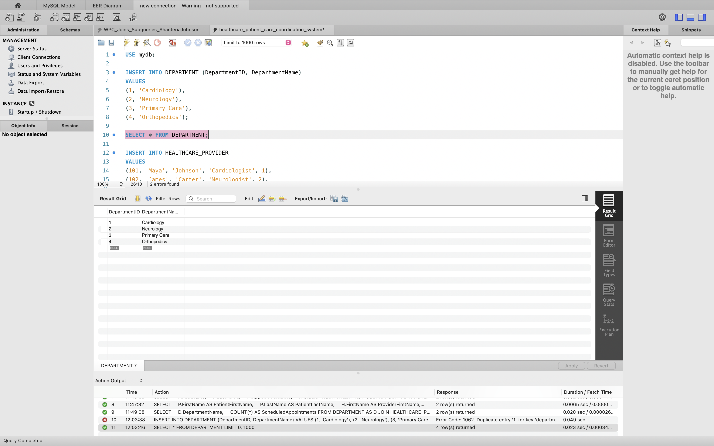
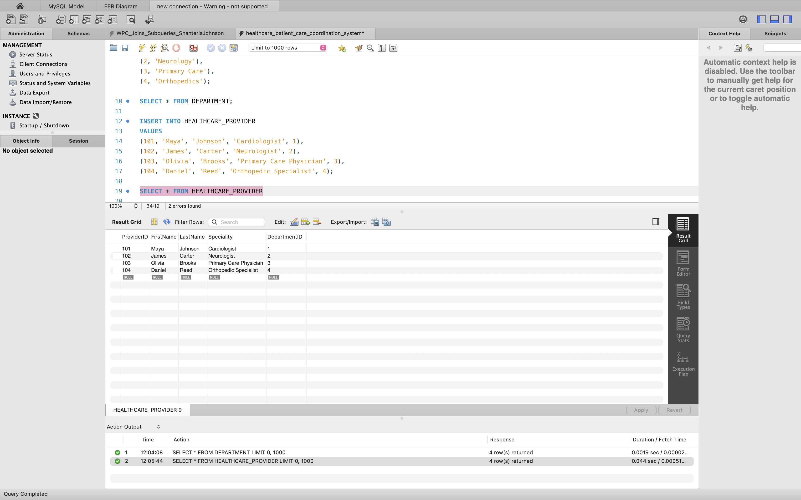
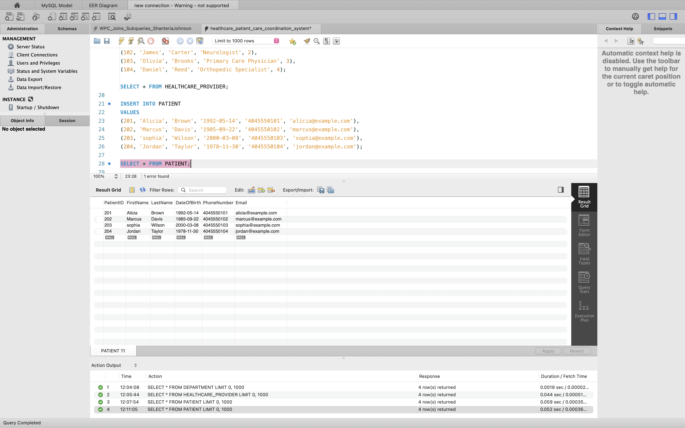
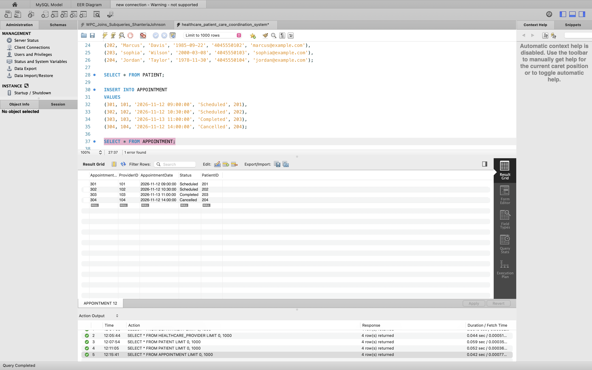
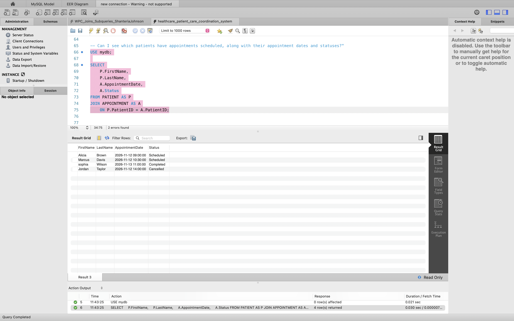
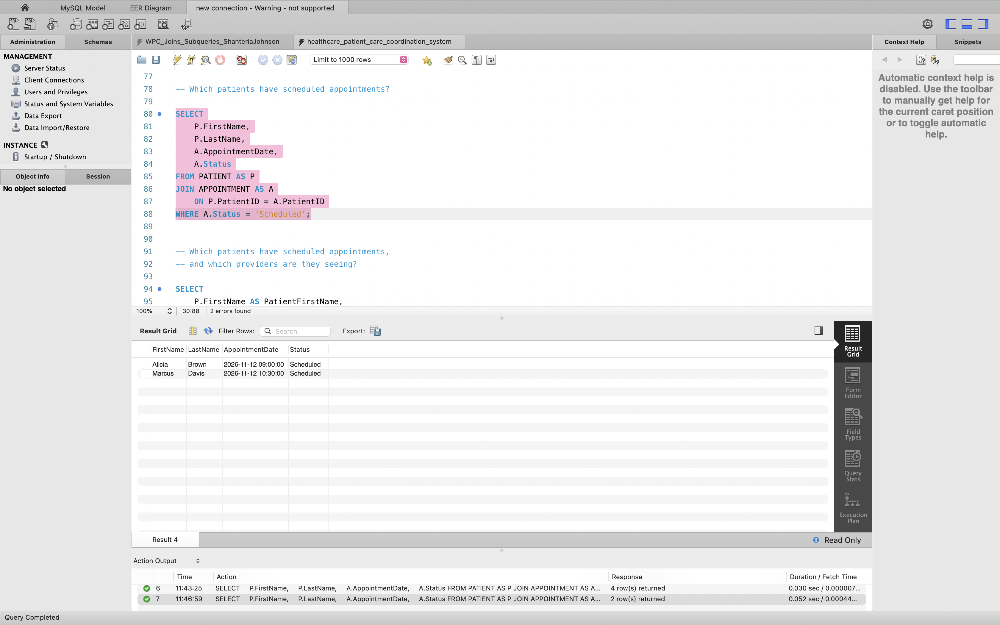
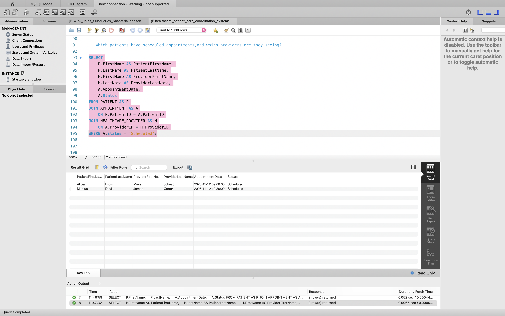
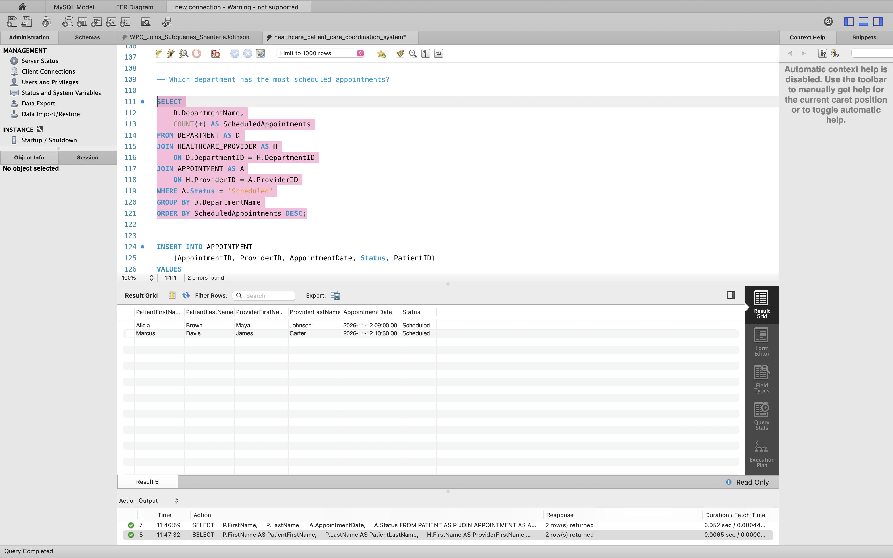
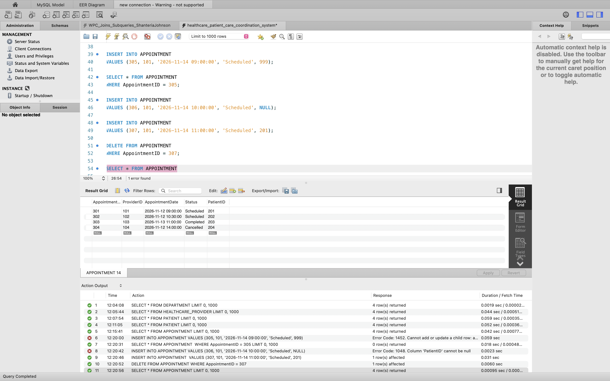

# Healthcare Patient Care Coordination System

## About This Project

For my Introduction to Databases class at Georgia Gwinnett College, I built a database to organize patient information, healthcare providers, departments, and appointments.

Think of it as a way to keep related healthcare information in one place. Instead of looking through separate lists, you can connect the information to answer questions like: **Which patient has an appointment, and which provider are they seeing?**

This is a learning project, not a system used by a real healthcare organization.

## How I Built It

### 1. Planning the Database

I started by drawing a diagram in MySQL Workbench to plan how the information would be organized.

I created four tables for patients, healthcare providers, departments, and appointments. I then connected them so the database could keep track of how the information relates.

### 2. Creating the Database

After finishing the diagram, I used a MySQL Workbench feature called **Forward Engineering**. It turned my design into the SQL instructions needed to create the database tables.

You can also view the [SQL file used to create the database structure](healthcare_database_schema.sql).

### 3. Adding Sample Information

Next, I added fictional information to each of the four tables. I used SQL to enter the records and then checked that they appeared in the database.

**Departments**

I started by adding four departments: Cardiology, Neurology, Primary Care, and Orthopedics.

**Healthcare providers**

Next, I added four healthcare providers and assigned each one to a department.

**Patients**

I added four fictional patients, including their names, dates of birth, and contact information.

**Appointments**

Finally, I added four appointments, each connected to a patient and healthcare provider. The records included scheduled, completed, and cancelled appointments.

### 4. Finding Information with SQL

After adding sample information, I used SQL to answer questions about patients, appointments, and healthcare providers. Each question helped me practice finding and connecting information in different ways.

**Which patients have appointments, and what are their statuses?**

I connected patient and appointment records to see names, appointment dates, and whether appointments were scheduled, completed, or cancelled.

**Which patients have scheduled appointments?**

I narrowed the results to show only scheduled appointments. Two patients appeared in the results.

**Which patients have scheduled appointments, and which providers are they seeing?**

I connected patient, appointment, and provider information to see who each patient was scheduled to see.

**Which department has the most scheduled appointments?**

I counted scheduled appointments by department. In my sample data, Cardiology and Neurology were tied with one each.

### 5. Checking for Errors

I also tested whether my database could catch incorrect information.

For example, I tried adding an appointment with a patient ID that didn't exist and another without a patient ID. MySQL rejected both entries because appointments need to be connected to a valid patient.

I also tested an appointment status by typing `Scheduld` instead of `Scheduled`. The database rejected it because I had set a rule allowing only **Scheduled**, **Completed**, or **Cancelled**.

These tests helped me see how database rules can prevent mistakes before incorrect information gets saved.

## Tools I Used

- **MySQL Workbench:** To design the database and work with it
- **MySQL:** To store and organize the information
- **SQL:** To add, find, and check information

## What I Learned

This project helped me see how a database comes together, from planning the tables to using them to answer questions.

I also learned why connecting information correctly matters. A database isn't just about storing records. It's about organizing them so the information is useful and mistakes can be caught.

## What's Next

I'd like to expand the project by adding more tables and connecting more types of healthcare information. As I continue learning, I also want to use Python or R to explore the data and create charts.

---

*All patient and provider information in this project is fictional and used for classwork.*
